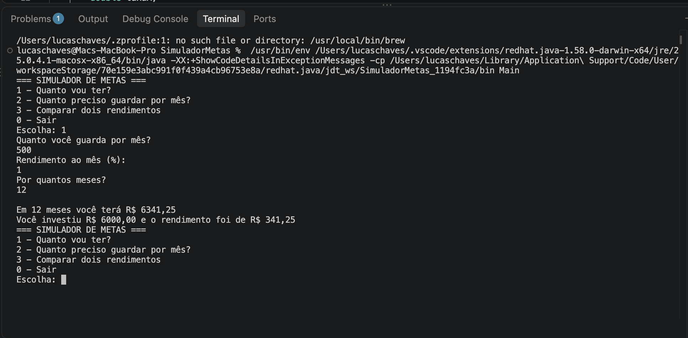

# Simulador de Metas

Programa de terminal em Java que calcula quanto você vai ter guardando dinheiro todo mês com rendimento, quanto precisa guardar para chegar a uma meta e qual de dois rendimentos compensa mais.



## Funcionalidades

- **Quanto vou ter?** Saldo final, total investido e rendimento.
- **Quanto preciso guardar por mês?** Depósito mensal necessário para atingir uma meta.
- **Comparar dois rendimentos:** saldo final de cada taxa e a diferença entre elas.
- Validação das entradas: depósito, meta e meses precisam ser maiores que zero, e a taxa não pode ser negativa. Se o valor for inválido, o programa pede de novo, sem travar.
- **Evolução mês a mês:** tabela com rendimento, depósito e saldo de cada mês.

## Como rodar

Requisito: Java 21 ou superior.

```bash
git clone https://github.com/lucasvchavess/simulador-metas.git
cd simulador-metas
java Main.java
```

Os números com casa decimal seguem o idioma do sistema: em português, digite `0,5`, não `0.5`.

## Como o cálculo funciona

O simulador considera que o depósito é feito no fim de cada mês. Todo mês acontece nesta ordem:

1. O dinheiro que já estava na conta rende a taxa do mês.
2. Entra o depósito do mês.

No primeiro mês a conta começa zerada, então não há nada para render: o saldo fica igual ao primeiro depósito. O rendimento só aparece a partir do segundo mês, sobre o dinheiro que ficou o mês inteiro aplicado.

| Mês | Saldo anterior | Rendimento (1%) | Depósito | Saldo final |
|-----|----------------|-----------------|----------|-------------|
| 1 | 0,00 | 0,00 | 500,00 | 500,00 |
| 2 | 500,00 | 5,00 | 500,00 | 1005,00 |
| 3 | 1005,00 | 10,05 | 500,00 | 1515,05 |

Fórmula usada (valor futuro com depósitos mensais):

```
saldo = depósito × ((1 + taxa)^meses − 1) / taxa
```

Quando a taxa é zero, essa fórmula dividiria por zero. Nesse caso, o programa usa `depósito × meses`.

Isso é uma simplificação: na vida real, investimentos como CDB e Tesouro Selic rendem todo dia útil, e a poupança rende no aniversário mensal de cada depósito.

## Exemplo

| Depósito | Taxa ao mês | Meses | Saldo final |
|---|---|---|---|
| R$ 500 | 1% | 12 | R$ 6341,25 |

## O que aprendi

- **A matemática foi a parte mais difícil.** Entender a fórmula de juros compostos com depósito mensal me travou mais do que o código. Depois que entendi o esquema mês a mês (rende, depois deposita), passar para Java foi tranquilo.
- **Converter a porcentagem.** A pessoa digita a taxa em porcentagem (1 para 1%), mas a fórmula precisa do valor decimal (0,01). Por isso o programa divide a taxa por 100 logo na leitura. Sem essa divisão, o cálculo entenderia que o dinheiro dobra todo mês.
- **Taxa zero quebrava a conta.** A fórmula divide pela taxa, então com taxa 0 o resultado aparecia como `Infinity` ou `NaN`. Resolvi com um `if/else`: quando a taxa é zero, o saldo é simplesmente `depósito × meses`.
- **`do while` para validar entrada.** Ele faz a pergunta primeiro e só depois confere se o valor é válido. Se não for, pergunta de novo. Assim o programa nunca segue com um valor negativo ou zerado.
- **`Math.abs` para a diferença.** Na comparação de rendimentos, `saldoA - saldoB` fica negativo quando o B rende mais. O `Math.abs` tira o sinal e deixa só o valor, e um `if` diz qual dos dois rendeu mais.
- **O que eu melhoraria.** O código tem repetição: a validação dos meses aparece três vezes, e a fórmula do saldo também. Se a regra mudar, preciso corrigir em vários lugares. O próximo passo é separar essas partes em métodos.

## Como usei IA

Usei a IA como professor, não como programador. Criei um projeto no Claude com uma instrução clara: ele não podia me dar o código pronto, só explicar e me fazer perguntas até eu chegar na solução. Sempre que eu travava, mandava a dúvida e recebia uma dica do caminho. Todo o código foi escrito por mim.

## Próximos passos

- Separar cada opção em um método

---

Feito por Lucas Chaves · [LinkedIn](https://www.linkedin.com/in/lucasvchavess/)